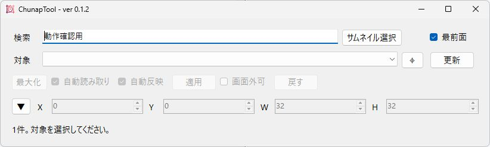
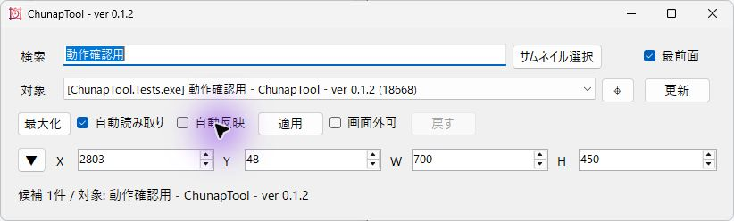
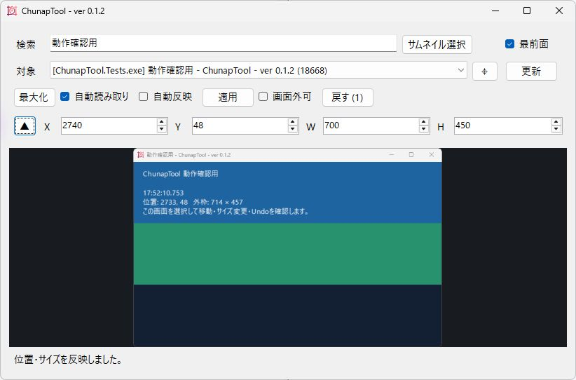
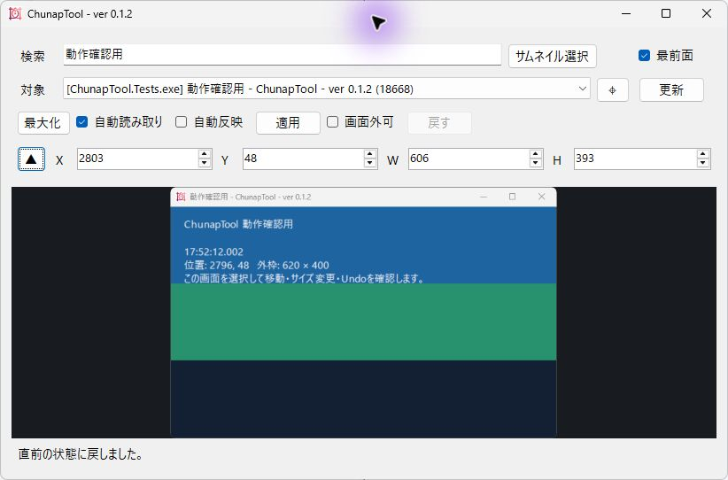
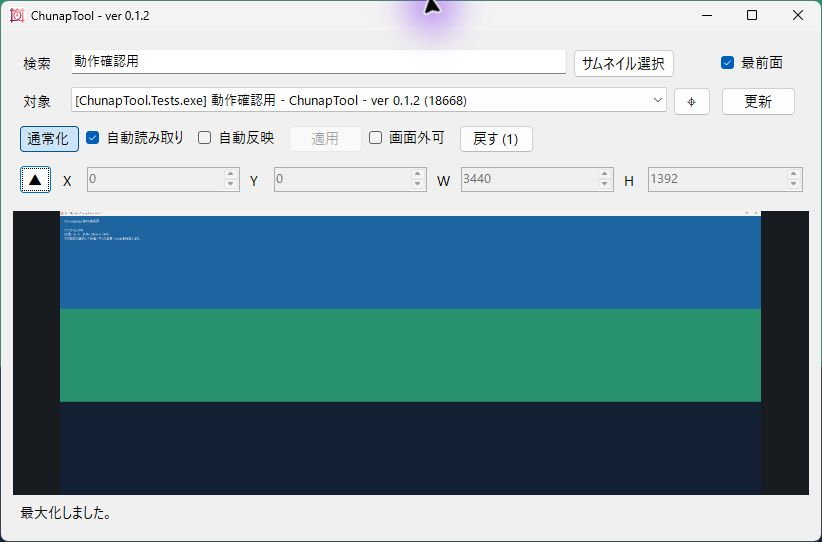

# ChunapTool

ウィンドウの位置・サイズ・最大化を調整するWindows向けツールです。対象を検索して選び、数値で配置を揃えられます。ライブプレビューと最大100手の「戻す」を備えます。

## 導入と起動

Windows 11 x64で利用できます。[GitHub Releases](https://github.com/KotorinChunChun/ChunapTool/releases)のインストーラー、またはKotorinToysの一覧から導入し、ChunapToolを起動してください。.NETランタイムは配布版に同梱しています。詳しくは[導入・更新・削除](docs/install.md)を参照してください。

以下は0.1.2系の画面です。操作対象は説明用のテストウィンドウです。

## 1. 調整するウィンドウを選ぶ

「検索」にタイトルや実行ファイル名を入力し、「対象」から選びます。「⌖」を目的のウィンドウへドラッグして選ぶこともできます。対象を選ぶまでは調整ボタンを押せません。

## 2. 位置とサイズを指定する

X・Yは位置、W・Hは幅・高さです。まず「自動反映」を外し、数値を入力してから「適用」を押すと、変更内容を確認しながら操作できます。「自動読み取り」は対象の現在の位置・サイズを読み取ります。

## 3. 適用した結果を確認する

「適用」で対象へ反映します。左の「▼」を押すとライブプレビューを開けます。「画面外可」を外している場合は、画面の作業領域内に収まるように位置を調整します。

## 4. 直前の配置に戻す

変更を取り消すときは「戻す」を押します。移動・サイズ変更・最大化の履歴を最大100手まで戻せます。履歴はアプリを終了すると消えます。

## 5. 最大化と通常表示を切り替える

「最大化」を押すと対象が最大化し、ボタンが「通常化」に変わります。最大化中はX・Y・W・Hの入力が無効になります。通常化するか「戻す」を押すと、再びサイズを指定できます。

## ほかの使い方

- 「サムネイル選択」では、画像とタイトルを見て対象を選べます。検索で候補を絞り、カードを押して確定します。
- 「最前面」はChunapTool自身を前に置く設定です。対象ウィンドウの設定ではありません。
- プレビューの「▲」を押すと、表示を閉じてプレビュー処理を止めます。
- 設定と履歴はファイルへ保存しません。起動時は既定値から始まります。

## 困ったとき

- **ボタンが押せない**：対象を選んでいるか確認してください。終了・最小化した対象では調整できません。
- **数値が勝手に変わる**：「自動読み取り」で現在値を表示しています。手入力だけで進めたい場合はOFFにしてください。
- **プレビューが黒い**：最小化や保護された画面では取得できないことがあります。対象を通常表示に戻してください。
- **別の版を起動したい**：起動済みのChunapToolを閉じてから起動してください。二重起動は既存画面を表示します。

詳しい使い方は[操作ガイド](docs/guide.md)、ソースからの起動・ビルド・テストは[開発手順](docs/guide.md#ビルドとテスト)、変更記録は[開発資料](dev/README.md)を参照してください。
