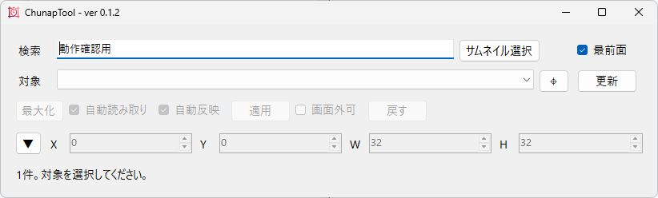
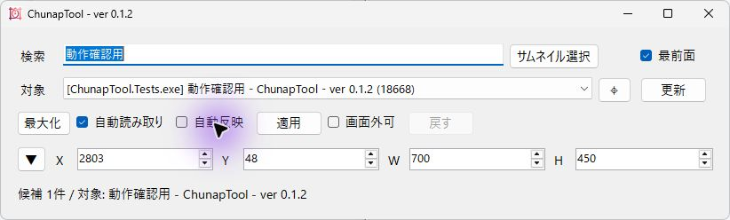
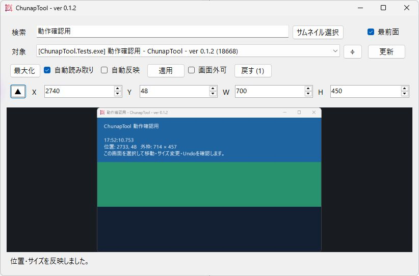
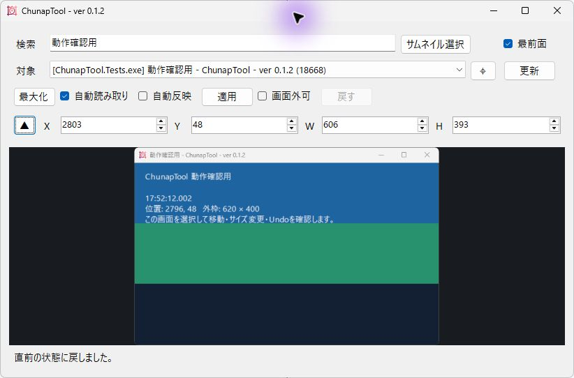
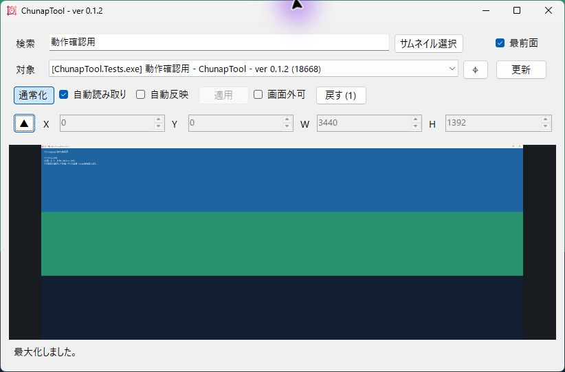

# ChunapTool

Windowsのウィンドウを選んで位置やサイズを変えたり、最大化したりするツールです。ドラッグやサムネイルで対象を選び、折りたためるライブプレビューで確認できます。「戻す」で最大100手まで取り消せます。

## 起動

[Releases](https://github.com/KotorinChunChun/ChunapTool/releases)の`ChunapTool-0.1.2-setup.exe`で利用者単位に導入できます。ランタイムを同梱した未署名の開発版です。KotorinToys 0.1.2以降の本体からも導入・更新・削除できます。[導入と保持・削除の手順](docs/install.md)を確認してください。

v0.1.3は公開準備中で、現在のReleasesはv0.1.2です。v0.1.3からは設定とプリセットを`%LOCALAPPDATA%\KotorinToys\ChunapTool\settings.json`へ保存します。保存先は導入先とは別なので、更新しても設定とプリセットは失われません。Undo履歴は保存しません。

Windows 11 x64向けの[ポータブル版](https://github.com/KotorinChunChun/ChunapTool/releases/tag/v0.1.1)はZIPをすべて展開し、`ChunapTool.exe`を起動します。.NET 10ランタイムを同梱しています。配布ZIPは未署名です。同じリリースの`SHA256SUMS.txt`でハッシュを確認できます。

v0.1.3からは位置・サイズ・最大化・プリセット・設定をコマンドラインから操作できます。`chunap.exe`は`ChunapTool.exe`と同じフォルダーにあります。使い方は[利用・開発ガイド](docs/guide.md)の「コマンドライン」を参照してください。全機能のコマンドライン化は次のv0.2.0で進めています。

ソースから起動する場合は.NET 10 SDKとPowerShell 7を使用します。

```powershell
cd <ChunapToolのクローン先>
pwsh -ExecutionPolicy Bypass -File dev/scripts/start.ps1
```

Python、OpenCV、FFmpegの準備は不要です。録画や動画編集機能は含みません。

## 使い方

1. タイトルまたは実行ファイル名で検索し、「対象」からウィンドウを選びます。右の「⌖」を対象ウィンドウへドラッグする方法でも選択できます。
2. 「自動読み取り」をONにすると、対象の位置・サイズの変化をX/Y/W/Hへ表示します。
3. 「自動反映」がONなら入力した変更が自動で反映されます。OFFなら数値を編集してから「適用」を押すと反映されます。
4. 「最大化」で最大化するとボタンが「通常化」に変わります。「戻す」で直前の位置・サイズ・最大化状態へ戻します。
5. 適用ボタンの右の「画面外可」で、モニターの作業領域を超える位置・サイズを許可するか切り替えます。
6. Xの左の「▼」でプレビューを開き、「▲」で閉じます。通常は折りたたんだ状態で起動します。
7. 「基準」で、X/Y/W/Hを見える枠で扱うか、中身（クライアント領域）で扱うかを選びます。「比率固定」で縦横比を保ち、「プリセット ▼」で登録したサイズにします（v0.1.3から）。

画像から探す場合は「サムネイル選択」を押します。作業領域いっぱいに開く選択画面で画像とウィンドウ名を確認し、クリックして対象を確定します。検索結果は入力した直後に絞り込まれ、画像は1枚ずつ数秒おきに更新されます。選択または取消で画面を閉じると撮影も停止します。

現在の公開版はv0.1.2、次の公開予定はv0.1.3です。ソースは[GitHubリポジトリ](https://github.com/KotorinChunChun/ChunapTool)、詳しくは[利用・開発ガイド](docs/guide.md)、変更と検証状況は[開発資料](dev/README.md)、移植時の抽出範囲は[v0.1.0実装記録](dev/history/v0.1.0/v0.1.0-imp.md)を参照してください。v0.1.2公開後の修正（管理pipeの受付継続、スナップ中の位置へのUndo、表示倍率125%などでの配置、二重起動時の案内ほか）は[コードレビュー修正記録](dev/research/code-review-2026-10-25/report.md)にあり、v0.1.3に含めます。v0.1.3の内容は[v0.1.3の記録](dev/history/v0.1.3/v0.1.3-imp.md)を参照してください。

KotorinToys配下の独立リポジトリです。本体からの開発版起動・停止・状態確認に対応しています。

## 1. 調整するウィンドウを選ぶ

「検索」にタイトルや実行ファイル名を入力し、「対象」の一覧からウィンドウを選びます。「⌖」を目的のウィンドウへドラッグして選ぶこともできます。対象を選ぶまでは調整ボタンを押せません。



## 2. 位置とサイズを指定する

X・Yは位置、W・Hは幅・高さです。まず「自動反映」を外し、数値を入力してから「適用」を押すと、変更内容を確認しながら操作できます。「自動読み取り」は対象の現在の位置・サイズを読み取ります。



## 3. 適用した結果を確認する

「適用」で対象へ反映します。左の「▼」を押すとライブプレビューを開けます。「画面外可」を外している場合は、画面の作業領域内に収まるように位置を調整します。



## 4. 直前の配置に戻す

変更を取り消すときは「戻す」を押します。移動・サイズ変更・最大化の履歴を最大100手まで戻せます。履歴はアプリを終了すると消えます。



## 5. 最大化と通常表示を切り替える

「最大化」を押すと対象が最大化し、ボタンが「通常化」に変わります。最大化中はX・Y・W・Hの入力が無効になります。通常化するか「戻す」を押すと、再びサイズを指定できます。



## ほかの使い方

- 「サムネイル選択」では画像とタイトルを見て対象を選べます。検索で候補を絞り、カードを押して確定します。
- 「最前面」で手前に表示するのはChunapTool自身です。対象ウィンドウの設定ではありません。
- プレビューの「▲」を押すと、表示を閉じてプレビュー処理を止めます。
- v0.1.2では設定と履歴をファイルへ保存しません。起動時は既定値から始まります。

## 困ったとき

- ボタンが押せないときは対象を選んでいるか確認してください。対象が終了した場合や最小化している場合は調整できません。
- 数値が勝手に変わるのは「自動読み取り」で現在値を表示しているためです。手入力だけで進めたい場合はOFFにしてください。
- プレビューが黒いときは対象を通常表示に戻してください。最小化中や保護された画面は取得できないことがあります。
- 別のバージョンを起動するときは、起動済みのChunapToolを閉じてから起動してください。二重起動すると既存の画面を表示します。

詳しい使い方は[操作ガイド](docs/guide.md)、ソースからの起動・ビルド・テストは[開発手順](docs/guide.md#ビルドとテスト)、変更記録は[開発資料](dev/README.md)を参照してください。

## KotorinToys管理連携（2026-10-15追加）

本体の一覧からの開発版起動・既存画面表示・状態確認・正常停止に対応しました。v0.1.2からは本体からの導入・更新・削除にも対応しています（[導入と削除](docs/install.md)）。[管理連携と検証用起動](docs/kotorintoys-integration.md)を参照してください。
